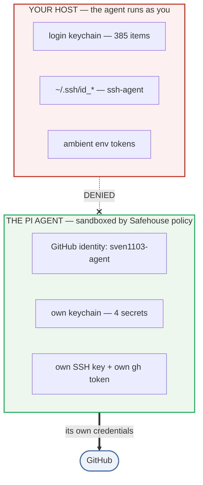
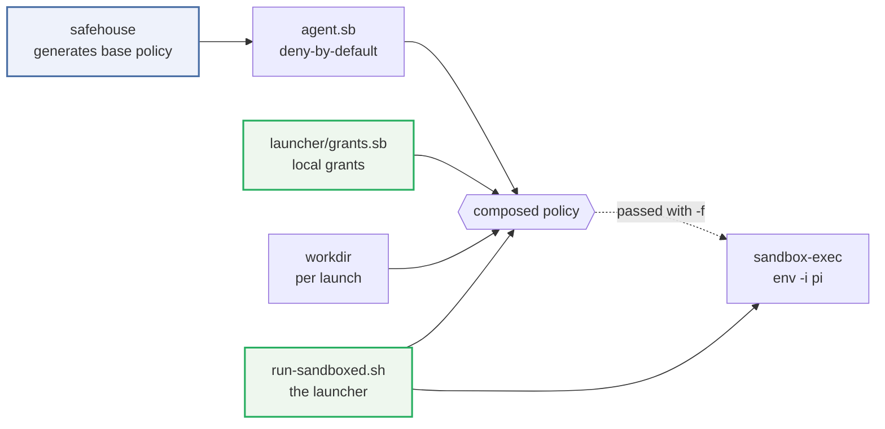

# Sandboxing a local coding agent on macOS

**A worked write-up of confining the [pi](https://github.com/earendil-works/pi) coding agent with
[Agent Safehouse](https://agent-safehouse.dev), in a policy configuration that lets it act on
GitHub as its own companion account — while it cannot read *your* credentials on the host.**

Same machine, same user, no second account. **9 credential leaks → 0.** Every claim here was
measured on a real system, not reasoned about.

> **Start here** — [`launcher/run-sandboxed.sh`](launcher/run-sandboxed.sh) the launcher ·
> [`launcher/grants.sb`](launcher/grants.sb) the policy fragment · [`TESTING.md`](TESTING.md) the
> harness · [`FINDINGS.md`](FINDINGS.md) what was exposed (F1–F13) ·
> [`STEP-01`](STEP-01-agent-github-identity.md)→[`06`](STEP-06-personal-gh-config.md) what changed



## The idea

A local agent runs **as you** — same UID, same `~/.ssh`, same login keychain, same environment.
Any prompt injection or leaked token is then effectively your credential. Two things did the work:

1. **Least-privilege credentials, not hiding.** Give the agent its **own** GitHub identity and
   keychain, then remove its need for yours.
2. **Verify with a DENY/ALLOW harness**, recording a baseline before every change.

**[Agent Safehouse](https://agent-safehouse.dev)** (Apache-2.0) composes the deny-by-default
macOS `sandbox-exec` policy. This repo is the **launcher and local policy configuration** layered
on top of it — which is where every step actually lands — plus the measurements, and the mistakes.



## The launcher is the integration point

[`launcher/run-sandboxed.sh`](launcher/run-sandboxed.sh) composes the policy and starts the agent.
It is small, and it is where the hardening lives — read it first if you read only one file:

| in the launcher | what it does |
|---|---|
| **policy composition** | base policy + workdir grant + `grants.sb`, concatenated in that order |
| **keychain unlock** | prompts *before* entering the sandbox (an unlock outside is inherited inside) |
| **`env -i` allowlist** | starts from an **empty** environment — Step 5 |
| **`exec`** | replaces the shell, so the environment passed is the sanitized one |

[`launcher/grants.sb`](launcher/grants.sb) is the local policy fragment, and the reason the
hardening works at all: it is appended **after** the generated policy, and SBPL is
**last-match-wins**, so a deny here overrides any broad allow the base policy contains. Every step
landed there rather than in the generated file, which is regenerated on upgrade.

The base `agent.sb` (~48 KB, host-specific) is **not** vendored — generate your own:

```bash
safehouse --stdout > ~/.config/sandbox-exec/agent.sb
```

Both files are genericised: they use `HOME_DIR` and the `home-literal` / `home-subpath` helpers
from the generated policy, so they carry **no absolute user paths**.

## Where to look

| If you want… | Read |
|---|---|
| **The launcher** — composes the policy, unlocks, sanitizes, execs | **[`launcher/run-sandboxed.sh`](launcher/run-sandboxed.sh)** |
| **The policy fragment** where every step landed | [`launcher/grants.sb`](launcher/grants.sb) |
| **The harness** — DENY/ALLOW suites, baseline + diff workflow | [`TESTING.md`](TESTING.md) |
| **What was exposed** and how it was found (F1–F13) | [`FINDINGS.md`](FINDINGS.md) |
| **What was actually changed**, step by step | [`STEP-01`](STEP-01-agent-github-identity.md) → [`STEP-06`](STEP-06-personal-gh-config.md) |
| Raw evidence, line numbers, reproduction commands | [`EVIDENCE.md`](EVIDENCE.md) |
| What Safehouse does *and does not* promise | [`UPSTREAM_STANCE.md`](UPSTREAM_STANCE.md) |

Each `scripts/apply-step-*.sh` is idempotent, backs up first, refuses to run from inside the
sandbox, and verifies functionally — rolling back automatically on failure.

## Results

Nine credential-exposure leaks before, **zero** after — with the agent's own capability intact:

```
  DENY  17/17 ok      the human's credentials are unreachable
  ALLOW 14/14 ok      the agent's own credentials keep working
  PASS
```

| | before | after |
|---|---|---|
| login keychain | reachable | **denied** |
| System keychain | reachable | **denied** |
| personal GitHub token | reachable | **denied** |
| sign as you (ssh-agent) | **reachable** | **denied** (env + policy) |
| ambient env tokens | **reachable** | **denied** (`env -i`) |
| agent's own keys, SSH, `gh` | n/a | **all working** |

Keychain enumeration, measured identically both times:

```
  unconfined          : 385 items
  inside the sandbox  :   4 items   (only the agent's own)
```

## Steps applied

| Step | What it did |
|---|---|
| [01](STEP-01-agent-github-identity.md) · [01b](STEP-01b-gh-token-in-agent-keychain.md) | Agent's own GitHub identity — SSH key, token in its own keychain |
| [02](STEP-02-wire-agent-identity.md) | Wire it in: `GH_CONFIG_DIR`, `GIT_CONFIG_*`; close the gitconfig→keychain route |
| [03](STEP-03-remove-keychain-grant.md) · [03b](STEP-03b-agent-keychain.md) | Remove the keychain grant; give the agent a **dedicated keychain** |
| [04](STEP-04-ssh-agent-deny.md) | Deny ssh-agent in the policy |
| [05](STEP-05-env-sanitization.md) | **`env -i` allowlist** — closes environment inheritance |
| [06](STEP-06-personal-gh-config.md) | Deny the personal `gh` config |

## The non-obvious findings

The parts I could not find documented elsewhere. Each cost real debugging time — see
[`FINDINGS.md`](FINDINGS.md).

- **SBPL is last-match-wins.** A `deny` after a broad `allow` wins; the reverse does not.
- **`SecurityServer` mach-lookup is required even for your own keychain** — yet a *file* deny
  still holds. The keychain is all-or-nothing via IPC, so least privilege beats path hiding.
- **Keychain lookups fall through.** File-deny `login` and `security` falls through to the next
  entry — the whole trick behind the agent's own keychain, with **no per-session state change**.
  Break the single file holding the search list and *every* provider fails with no useful error.
- **`security create-keychain` mutates user-wide state** — it was observed dropping the login
  keychain from your shell's search list.
- **`exec` defeats an `EXIT` trap**, so a per-session restore built that way silently never ran.
- **Environment variables are not a filesystem concept** — *no* SBPL rule can constrain them.
  `sandbox-exec … env VAR=x pi` only *adds*; it never restricts.
- **Subagents inherit confinement, they do not re-apply it.** Sanitizing at the launcher fixes
  the agent *and* every subagent at once.

### Mistakes I made, and kept

- **A retracted finding.** "The sandbox is bypassable" was an artifact of running from `$HOME`,
  which appends a whole-home grant. See F1/F11.
- **Four cases of measuring the wrong thing** — including a harness that reported leaks the real
  session could not have, and a probe that silently tested nothing. All now guarded, some with
  negative controls.
- **A backup that preserved the secret it was meant to protect.** *A backup is a copy of the
  secret.*

## Caveats — read before trusting this

- **A hardening layer, not a security boundary.** Not a VM. Code execution can still exfiltrate
  anything the agent may legitimately read.
- **Unrestricted network egress remains** (F8) — outside the scope of a credential sandbox.
- **The agent keychain stays unlocked** until you lock it or reboot. A deliberate trade-off: a
  300s auto-lock caused a prompt storm with subagents. Revert with
  `security set-keychain-settings -t 300 -l ~/.agent/agent.keychain-db`.
- **macOS-only**, and tied to the layout of the safehouse-generated policy. The *techniques*
  generalise; the exact rules do not.

## Reproducing / adapting

Genericised — endpoints, org names and personal details are placeholders. Override via
environment variables rather than editing files:

```bash
MODEL_ENDPOINT="https://your-gateway.example.org" \
LITELLM_MODELS_URL="https://your-gateway.example.org/v1/models" \
  scripts/selftest.sh
```

See [`TESTING.md`](TESTING.md) for the full table. Git hooks live in `scripts/hooks/` — install
with `scripts/install-hooks.sh`.

## License

MIT — see [`LICENSE`](LICENSE). Upstream
[Agent Safehouse](https://github.com/eugene1g/agent-safehouse) is Apache-2.0 and is **not**
vendored here.
