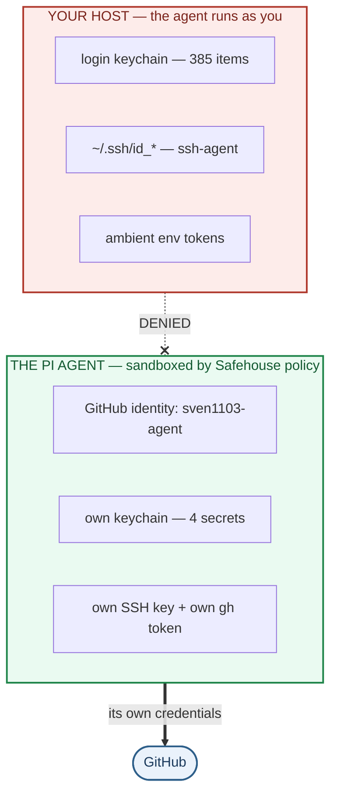
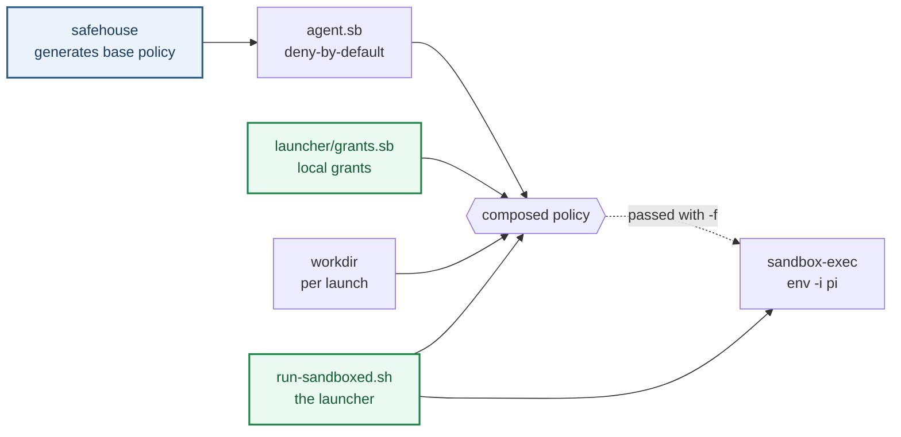

# Sandboxing a local coding agent on macOS

**A worked write-up of confining the [pi](https://github.com/earendil-works/pi) coding agent with
[Agent Safehouse](https://agent-safehouse.dev), in a policy configuration that lets it act on
GitHub as its own companion account — while it cannot read *your* credentials on the host.**

Same machine, same user, no second account. **9 credential leaks → 0.** Every claim here was
measured on a real system, not reasoned about.

> **Start here** — [`launcher/run-sandboxed.sh`](launcher/run-sandboxed.sh) the launcher ·
> [`launcher/grants.sb`](launcher/grants.sb) the policy fragment · [`TESTING.md`](TESTING.md) the
> harness · [`FINDINGS.md`](FINDINGS.md) what was exposed (F1–F13) ·
> [`STEP-01`](STEP-01-agent-github-identity.md)→[`06`](STEP-06-personal-gh-config.md) what changed
>
> **Cloned this repo?** Read [`SETUP-IDENTITY.md`](SETUP-IDENTITY.md) first — without it your
> agent commits and pushes as *you*.
>
> **This is a demonstration, not a template.** It documents one specific configuration. To build
> your own, use upstream's **[Policy Builder](https://agent-safehouse.dev/policy-builder)**.



## The idea

A local agent runs **as you** — same UID, same `~/.ssh`, same login keychain, same environment.
Any prompt injection or leaked token is then effectively your credential. Two things did the work:

1. **Least-privilege credentials, not hiding.** Give the agent its **own** GitHub identity and
   keychain, then remove its need for yours.
2. **Verify with a DENY/ALLOW harness**, recording a baseline before every change.

**[Agent Safehouse](https://agent-safehouse.dev)** (Apache-2.0) composes the deny-by-default
macOS `sandbox-exec` policy. This repo is a **worked example** of a launcher and local policy
layered on top of it — which is where every step actually lands — plus the measurements, and the
mistakes.



## The launcher is the integration point

[`launcher/run-sandboxed.sh`](launcher/run-sandboxed.sh) composes the policy and starts the agent.
It is small, and it is where the hardening lives — read it first if you read only one file:

| in the launcher | what it does |
|---|---|
| **policy composition** | base policy + workdir grant + `grants.sb`, concatenated in that order |
| **keychain unlock** | prompts *before* entering the sandbox (an unlock outside is inherited inside) |
| **`env -i` allowlist** | starts from an **empty** environment — Step 5 |
| **`exec`** | replaces the shell, so the environment passed is the sanitized one |

[`launcher/grants.sb`](launcher/grants.sb) is the local policy fragment, and the reason the
hardening works at all: it is appended **after** the generated policy, and SBPL is
**last-match-wins**, so a deny here overrides any broad allow the base policy contains.
The policy steps (02, 03b, 04, 06) all landed there rather than in the generated file,
which is regenerated on upgrade. Steps 01/01b created credentials, and Step 05 is the
launcher's `env -i` — neither is a policy rule, so they live outside this fragment.

**These two files are installed, not copies.** `launcher/` in this repo is the single
source of truth for the running configuration:

```bash
scripts/install-launcher.sh --dry-run   # show what differs
scripts/install-launcher.sh             # install, then verify (rolls back on failure)
```

The installer backs up the current files, copies `launcher/run-sandboxed.sh` and
`launcher/grants.sb` into `~/.config/sandbox-exec/`, then *executes* the launcher
against a stub `sandbox-exec` to prove it still starts the agent with the intended
environment — and restores the backups if any check fails. Running it twice is a
no-op. This exists because the repo copy and the live copy had already drifted once:
nothing installed or diffed them, so the README and `TESTING.md` came to point at
two different programs.

The base `agent.sb` (~48 KB, host-specific) is **not** vendored — generate your own.

## Build your own — don't copy ours

This repo's fragment is **one configuration**, not a baseline. It encodes choices specific to one
setup (a companion GitHub account, a dedicated keychain, an `env -i` allowlist) and carries the
trade-offs that come with them. Copying it wholesale would import assumptions that may not hold
for you.

Upstream provides three supported ways to generate a policy for *your* machine:

| Approach | Best for |
|---|---|
| **[Policy Builder](https://agent-safehouse.dev/policy-builder)** — interactive wizard | Most people. Pick agents, capabilities and filesystem access in plain language; no hand-editing. |
| **[`llm-instructions.txt`](https://agent-safehouse.dev/llm-instructions.txt)** — a prompt for an LLM | Generating a least-privilege profile tuned to your toolchain. |
| **[Getting Started](https://agent-safehouse.dev/docs/getting-started)** — the CLI | Scripting and CI: `safehouse --stdout > agent.sb` |

A sensible path: **start from an upstream-generated policy**, verify what it grants, then add only
the specific denies your threat model needs. Use our `grants.sb` as a worked example of *which*
rules close *which* holes — the comments explain the reasoning, which is the reusable part.

Two things worth knowing before you write your own denies:

- **Append, don't edit.** Safehouse regenerates the base policy on upgrade, so put your rules in
  an `--append-profile` fragment. SBPL is last-match-wins, so an appended deny overrides a broad
  allow above it. That property is what makes this approach safe.
- **Environment variables are not policy.** No SBPL rule can constrain them; `sandbox-exec … env
  VAR=x app` only *adds* variables. If a secret is in the environment, it reaches the agent
  regardless of the policy. Sanitize the environment separately (Step 5).

If you do hand-edit a generated policy anyway, check whether a newer Safehouse would generate
something stricter — see [`UPSTREAM_STANCE.md`](UPSTREAM_STANCE.md) and the open question Q8.4.

### If you clone this repo — give your agent its own git identity first

The companion-account setup only works end to end if the agent commits and pushes
**as itself**. `user.name`, `signingkey` and `sshCommand` live in `.git/config`,
which is not part of a repository, so a fresh clone silently falls back to *your*
identity: pushes are denied, and commits are authored by you without warning.

[`SETUP-IDENTITY.md`](SETUP-IDENTITY.md) has the steps — six `git config --local`
lines plus registering the signing key on the agent's account, written so you
substitute your own agent's values. It applies equally to any repo where you want
the agent to act as itself.

## Where to look

| If you want… | Read |
|---|---|
| **The launcher** — composes the policy, unlocks, sanitizes, execs | **[`launcher/run-sandboxed.sh`](launcher/run-sandboxed.sh)** |
| **The policy fragment** — where the policy steps landed (02, 03b, 04, 06) | [`launcher/grants.sb`](launcher/grants.sb) |
| **The harness** — DENY/ALLOW suites, baseline + diff workflow | [`TESTING.md`](TESTING.md) |
| **What was exposed** and how it was found (F1–F13) | [`FINDINGS.md`](FINDINGS.md) |
| **What was actually changed**, step by step | [`STEP-01`](STEP-01-agent-github-identity.md) → [`STEP-06`](STEP-06-personal-gh-config.md) |
| Raw evidence, line numbers, reproduction commands | [`EVIDENCE.md`](EVIDENCE.md) |
| What Safehouse does *and does not* promise | [`UPSTREAM_STANCE.md`](UPSTREAM_STANCE.md) |
| **Cloned this repo?** Your agent needs its own git identity first | [`SETUP-IDENTITY.md`](SETUP-IDENTITY.md) |
| The original plan, written before implementation *(historical)* | [`MITIGATION_PLAN.md`](MITIGATION_PLAN.md) |
| Decisions that were open, and how they resolved *(historical)* | [`OPEN_QUESTIONS.md`](OPEN_QUESTIONS.md) |

Each `scripts/apply-step-*.sh` is idempotent, backs up first, refuses to run from inside the
sandbox, and verifies functionally — rolling back automatically on failure.

## Results

Nine credential-exposure leaks before, **zero** after — with the agent's own capability intact:

```
  DENY  17/17 ok      the human's credentials are unreachable
  ALLOW 14/14 ok      the agent's own credentials keep working
  PASS
```

| | before | after |
|---|---|---|
| login keychain | reachable | **denied** |
| System keychain | reachable | **denied** |
| personal GitHub token | reachable | **denied** |
| sign as you (ssh-agent) | **reachable** | **denied** (env + policy) |
| ambient env tokens | **reachable** | **denied** (`env -i`) |
| agent's own keys, SSH, `gh` | n/a | **all working** |

Keychain enumeration, measured identically both times:

```
  unconfined          : 385 items
  inside the sandbox  :   4 items   (only the agent's own)
```

## Steps applied

| Step | What it did |
|---|---|
| [01](STEP-01-agent-github-identity.md) · [01b](STEP-01b-gh-token-in-agent-keychain.md) | Agent's own GitHub identity — SSH key, token in its own keychain |
| [02](STEP-02-wire-agent-identity.md) | Wire it in: `GH_CONFIG_DIR`, `GIT_CONFIG_*`; close the gitconfig→keychain route |
| [03](STEP-03-remove-keychain-grant.md) · [03b](STEP-03b-agent-keychain.md) | Remove the keychain grant; give the agent a **dedicated keychain** |
| [04](STEP-04-ssh-agent-deny.md) | Deny ssh-agent in the policy |
| [05](STEP-05-env-sanitization.md) | **`env -i` allowlist** — closes environment inheritance |
| [06](STEP-06-personal-gh-config.md) | Deny the personal `gh` config |

## The non-obvious findings

The parts I could not find documented elsewhere. Each cost real debugging time — see
[`FINDINGS.md`](FINDINGS.md).

- **SBPL is last-match-wins.** A `deny` after a broad `allow` wins; the reverse does not.
- **`SecurityServer` mach-lookup is required even for your own keychain** — yet a *file* deny
  still holds. The keychain is all-or-nothing via IPC, so least privilege beats path hiding.
- **Keychain lookups fall through.** File-deny `login` and `security` falls through to the next
  entry — the whole trick behind the agent's own keychain, with **no per-session state change**.
  Break the single file holding the search list and *every* provider fails with no useful error.
- **`security create-keychain` mutates user-wide state** — it was observed dropping the login
  keychain from your shell's search list.
- **`exec` defeats an `EXIT` trap**, so a per-session restore built that way silently never ran.
- **Environment variables are not a filesystem concept** — *no* SBPL rule can constrain them.
  `sandbox-exec … env VAR=x pi` only *adds*; it never restricts.
- **Subagents inherit confinement, they do not re-apply it.** Sanitizing at the launcher fixes
  the agent *and* every subagent at once.

### Mistakes I made, and kept

- **A retracted finding.** "The sandbox is bypassable" was an artifact of running from `$HOME`,
  which appends a whole-home grant. See F1/F11.
- **Four cases of measuring the wrong thing** — including a harness that reported leaks the real
  session could not have, and a probe that silently tested nothing. All now guarded, some with
  negative controls.
- **A backup that preserved the secret it was meant to protect.** *A backup is a copy of the
  secret.*

## Caveats — read before trusting this

- **A hardening layer, not a security boundary.** Not a VM. Code execution can still exfiltrate
  anything the agent may legitimately read.
- **Unrestricted network egress remains** (F8) — outside the scope of a credential sandbox.
- **The agent keychain stays unlocked** until you lock it or reboot. A deliberate trade-off: a
  300s auto-lock caused a prompt storm with subagents. Revert with
  `security set-keychain-settings -t 300 -l ~/.agent/agent.keychain-db`.
- **macOS-only**, and tied to the layout of the safehouse-generated policy. The *techniques*
  generalise; the exact rules do not.

## Reproducing / adapting

Genericised — endpoints, org names and personal details are placeholders. Override via
environment variables rather than editing files:

```bash
MODEL_ENDPOINT="https://your-gateway.example.org" \
LITELLM_MODELS_URL="https://your-gateway.example.org/v1/models" \
  scripts/selftest.sh
```

See [`TESTING.md`](TESTING.md) for the full table. Git hooks live in `scripts/hooks/` — install
with `scripts/install-hooks.sh`.

## License

MIT — see [`LICENSE`](LICENSE). Upstream
[Agent Safehouse](https://github.com/eugene1g/agent-safehouse) is Apache-2.0 and is **not**
vendored here.
