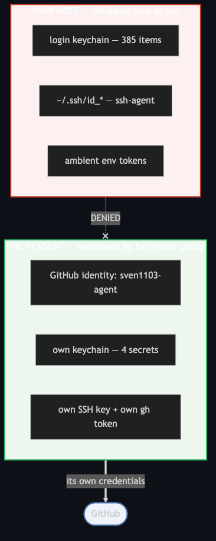
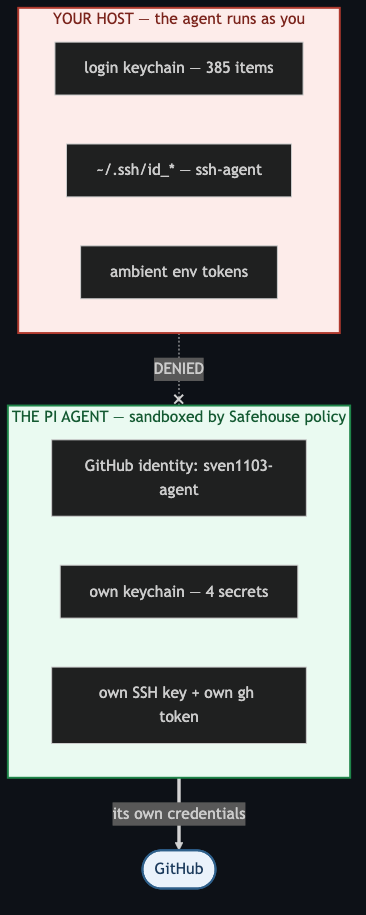
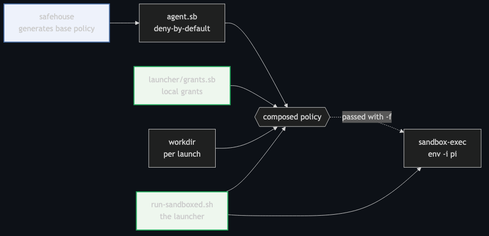
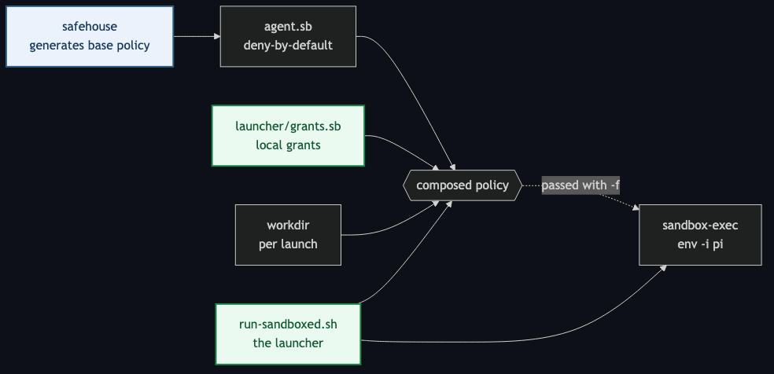

# Before / after — Mermaid figure readability

These four PNGs are rendered evidence for one finding: **the README's diagrams
were unreadable in GitHub's dark theme.**

Both figures used `style … fill:<light>` without a matching `color:`, so the
label text came from the theme. GitHub's dark theme renders it near-white, on
light fills.

**Host vs agent** — before (unreadable) and after:





**Composed-policy figure** — before and after:





## The measurement

Sampled from the rendered pixels (WCAG AA needs **4.5:1** for body text):

| element | before | after |
|---|---|---|
| `YOUR HOST` subgraph title | **1.10:1** | 16.55:1 |
| `THE PI AGENT` subgraph title | **1.08:1** | 17.52:1 |
| `GitHub` node label | **1.00:1** | 10.29:1 |
| `safehouse` node label | **1.12:1** | 10.29:1 |
| `launcher/grants.sb` node label | **1.10:1** | 7.66:1 |
| `run-sandboxed.sh` node label | **1.10:1** | 7.66:1 |
| card text (unstyled, for contrast) | 14.66:1 | 14.66:1 |

1.00:1 means the text is *the same colour as its background* — invisible. So the
figures did not look dimmed, they looked **broken**, and in figure 2 only the
styled labels disappeared while the unstyled ones stayed — an inconsistent
diagram rather than an obviously unreadable one.

## The fix

Pin `color:` on every styled element, so the text is explicit rather than
inherited:

```diff
- style HOST fill:#fdf0f0,stroke:#c0392b,stroke-width:2px
+ style HOST fill:#fdecea,stroke:#b03a2e,stroke-width:2px,color:#7b241c
```

Fills are nudged slightly lighter and strokes darker, keeping the red / green /
blue semantics. Verified in **both** themes after the change:

```
dark   HOST 16.55:1 · AGENT 17.52:1 · safehouse 10.29:1 · grants 7.66:1
light  HOST  8.70:1 · AGENT  7.66:1
```

## How these were produced

All four use the **same renderer and settings**, so the comparison is
apples-to-apples — including the two "before" images, which were re-rendered from
the pre-fix Mermaid source rather than taken from a browser screenshot:

```bash
# chrome needs --single-process to launch under the sandbox
cat > pptr.json <<'JSON'
{ "args": ["--no-sandbox","--disable-setuid-sandbox","--single-process",
           "--no-zygote","--disable-gpu"] }
JSON

# left = the pre-fix source (git show <commit>:README.md), right = current README
# extract each fenced mermaid block to its own .mmd, then:
mmdc -i figure.mmd -o out.png -p pptr.json -c dark.json -b '#0d1117' -w 1000
# where dark.json is: { "theme": "dark" }
```

Rendered with `@mermaid-js/mermaid-cli` in dark theme on `#0d1117` (GitHub dark's
canvas colour), 1000px wide.

## Why keep a broken image in the repo

The README claims every number was measured and that mistakes are kept rather
than tidied away (see the retracted finding F1 in [`FINDINGS.md`](../FINDINGS.md)).
A diagram-accessibility bug that only appears in one theme is exactly the kind of
thing that is easy to "fix" without evidence and easy to re-introduce. The
before-image is the evidence.
